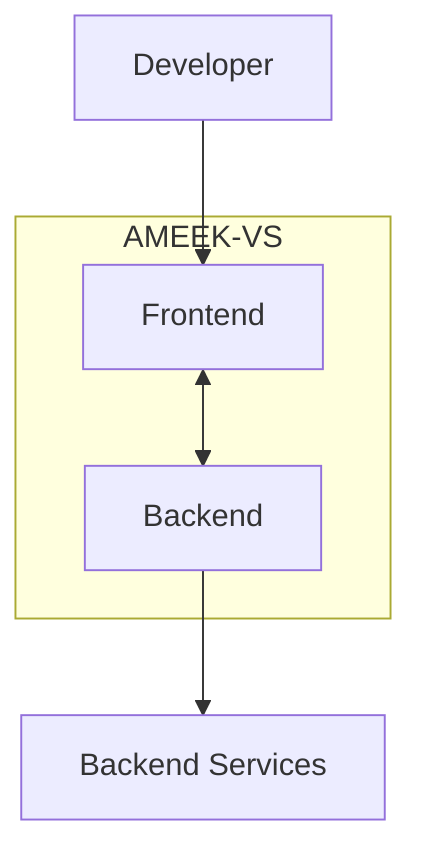

# AMEEK-VS

### A Modern Developer Workspace

**AMEEK-VS** is a developer-focused software project designed around the idea of bringing essential development capabilities together in one organized environment.

The project follows a modular architecture, with separate frontend and backend components, providing a foundation for building an integrated developer experience.

---

## Overview

Modern software development often involves switching between multiple applications, tools, terminals, and development environments.

AMEEK-VS aims to simplify this workflow by bringing development-related functionality into a unified workspace.

The project is organized into two primary components:

- **Frontend:** The user-facing application and interaction layer.
- **Backend:** The server-side application responsible for backend functionality and supporting services.

This separation helps maintain a modular codebase, making individual components easier to maintain, extend, and improve.

## The Problem

Developers frequently work across multiple disconnected tools to manage their development workflow.

This can introduce unnecessary complexity:

- Switching between different development applications.
- Managing separate tools for different tasks.
- Maintaining disconnected workflows.
- Dealing with fragmented development environments.
- Spending time navigating tools instead of focusing on building software.

AMEEK-VS is built around the goal of making development workflows more organized, accessible, and efficient.

## Project Vision

The vision behind AMEEK-VS is to create a flexible developer environment that brings useful development capabilities together through a unified interface.

The long-term goals include:

- A streamlined development experience.
- A modular and maintainable architecture.
- Integration with useful developer tools.
- Extensible functionality.
- An environment that can evolve alongside modern development workflows.

## Project Structure

The repository is separated into two primary applications:

| Directory | Responsibility |
|---|---|
| `frontend/` | User interface and client-side functionality |
| `backend/` | Server-side functionality and application services |

## Architecture

AMEEK-VS follows a separated frontend/backend architecture.



This architecture provides separation of concerns:

- The frontend handles user interaction.
- The backend handles server-side responsibilities.
- Communication between the two components connects the application.

## Technology Stack

AMEEK-VS uses a separate frontend and backend structure.

The exact frameworks, libraries, and runtime versions should be documented from the respective project manifests.

| Component | Technology |
|---|---|
| Frontend | See `frontend/package.json` |
| Backend | See `backend/package.json` |
| Runtime | Defined by project configuration |
| Dependencies | Defined in package manifests |
| Development tools | Defined by the development environment |

### Why a modular architecture?

A modular architecture offers several advantages:

- Independent development of frontend and backend.
- Easier debugging and maintenance.
- Clearer separation of responsibilities.
- Greater flexibility when introducing new functionality.

## Getting Started

### Prerequisites

Before working with AMEEK-VS, make sure you have:

- Git
- Node.js (if required by the project manifests)
- npm, pnpm, or yarn, according to the lockfiles
- A code editor such as Visual Studio Code

### 1. Clone the repository

```bash
git clone https://github.com/AbdullahAshfaq77/ameeks-vs.git
```

### 2. Navigate into the project

```bash
cd ameeks-vs
```

### 3. Install dependencies

Install dependencies separately in the frontend and backend directories using the package manager specified by their lockfiles.

```bash
cd frontend
npm install
```

Then:

```bash
cd ../backend
npm install
```

### 4. Configure environment variables

Check the backend and frontend configuration files for required environment variables.

If the project provides example environment files, use those as the starting point.

Never commit private credentials, API keys, or secrets.

### 5. Run the applications

Check the `scripts` section of each `package.json` for the available development commands.

Run the frontend and backend using their respective development scripts.

## Project Development

The project is organized to support independent development of its components.

### Frontend Development

The frontend is responsible for:

- User-facing functionality.
- Application navigation.
- Interface interactions.
- Communication with backend services.

### Backend Development

The backend is responsible for:

- Server-side application logic.
- Backend services.
- Processing application requests.
- Supporting frontend functionality.

## Configuration

Configuration should be managed through environment variables and project-specific configuration files.

Recommended practices:

- Keep sensitive values outside source code.
- Use environment-specific configuration.
- Avoid committing `.env` files containing secrets.
- Document required variables before running the application.

## Security Considerations

Security is an important consideration in application development.

Recommended security practices include:

- Validate incoming data on the server.
- Keep credentials and secrets private.
- Apply appropriate authentication and authorization.
- Handle errors without exposing sensitive information.
- Keep dependencies updated.
- Restrict access to sensitive backend functionality.
- Avoid trusting client-side validation alone.

## Development Philosophy

AMEEK-VS is built around several development principles:

**Modularity:** Keep application components organized and maintainable.

**Extensibility:** Make it possible to introduce new capabilities without unnecessarily complicating existing functionality.

**Usability:** Prioritize a clear and approachable developer experience.

**Maintainability:** Keep the codebase understandable and structured.

**Security:** Treat application security as an essential part of development.

## Roadmap

The following are potential development directions rather than claims about currently implemented functionality.

- [ ] Continue improving the developer experience.
- [ ] Expand available development tools.
- [ ] Improve frontend/backend integration.
- [ ] Enhance application performance.
- [ ] Improve documentation.
- [ ] Expand testing and quality assurance.
- [ ] Introduce additional integrations where useful.

## Contributing

Contributions, suggestions, and constructive feedback are welcome.

If you want to contribute:

1. Fork the repository.
2. Create a feature branch.
3. Make your changes.
4. Test your changes.
5. Submit a pull request with a clear description.

For larger changes, consider discussing the proposed implementation before starting development.

## License

Check the repository's license file for the applicable licensing terms.

If no license has been added, the project's usage and redistribution permissions should be clarified before treating it as open source.

---

## Author

**Abdullah Ashfaq**

GitHub: [@AbdullahAshfaq77](https://github.com/AbdullahAshfaq77)

Project: [AMEEK-VS](https://github.com/AbdullahAshfaq77/ameeks-vs)

---

<p align="center">
  **AMEEK-VS**
  <br/>
  <i>Building a more unified developer experience.</i>
</p>
